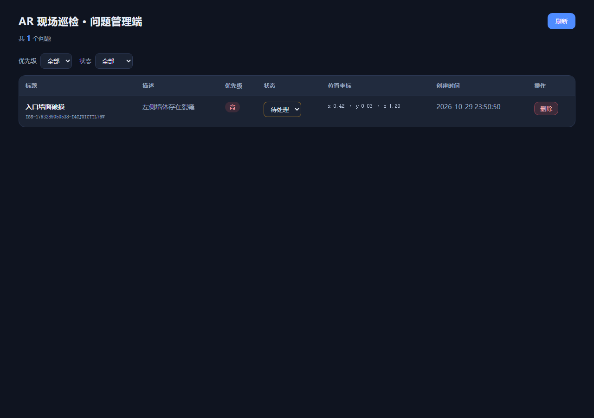
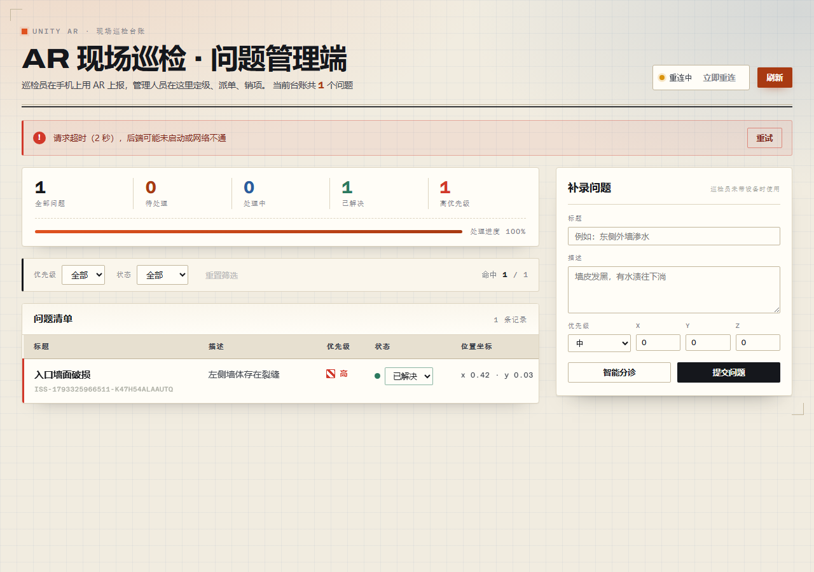

# Unity-AR 现场巡检问题标注（最小可运行原型）

园区巡检人员发现墙面破损、设备异常或安全隐患时，用手机在现场放置一个 AR 标记并上报问题；
管理人员在电脑网页里查看这些问题并更新处理状态。

本仓库打通了任务书要求的最小闭环：

```
Unity AR 放置标记并上报  →  Go 后端保存  →  React 页面查看问题  →  React 修改处理状态
```

| 管理端列表（真实后端 + 真实浏览器截图） | 后端不可用时的降级 |
| --- | --- |
|  |  |

> 详细的分步记录（每一步先写的测试、失败原因、具体做了什么、验证结果、提交信息）见
> **[`docs/STEP_LOG.md`](docs/STEP_LOG.md)**；任务拆解与计划见 [`docs/PLAN.md`](docs/PLAN.md)；
> 测试总览见 [`docs/TEST_REPORT.md`](docs/TEST_REPORT.md)；AI 使用记录见 [`AI_LOG.md`](AI_LOG.md)。

---

## 1. 仓库结构

```
.
├── server/                     # Go 后端（零第三方依赖）
│   ├── cmd/server/main.go      #   入口：-addr / -data 参数、优雅退出
│   ├── internal/model/         #   Issue / Priority / Status / Position + 唯一 ID
│   ├── internal/store/         #   JSON 文件持久化（临时文件 + 原子 rename）
│   ├── internal/api/           #   HTTP 路由、CORS、参数校验、统一错误结构
│   └── data/                   #   运行时数据目录（issues.json 已被 .gitignore 忽略）
├── web/                        # React + TypeScript 管理端
│   └── src/                    #   api.ts / App.tsx / components/ / __tests__/
├── unity/                      # Unity AR 客户端（AR Foundation）
│   ├── Assets/Scripts/Core/    #   纯逻辑（不依赖 UnityEngine，可被 .NET 单测编译）
│   ├── Assets/Scripts/Ar/      #   AR 会话、平面检测、标记放置
│   ├── Assets/Scripts/UI/      #   表单、API 客户端、状态条、后端地址设置
│   ├── Assets/Scripts/Input/   #   新旧输入系统兼容的点击抽象
│   ├── Assets/Editor/          #   一键生成场景、配置 Android/iOS AR 设置
│   └── Assets/Tests/EditMode/  #   NUnit 用例（Unity Test Runner 可直接跑）
├── tools/UnityLogicTests/      # .NET 测试工程：链接同一批 Core 源文件，无 Unity 也能跑单测
├── scripts/e2e.mjs             # 三端联调端到端脚本（真实后端 + 真实浏览器）
└── docs/                       # 规划、逐步记录、测试报告、截图
```

## 2. 技术栈与版本

| 部分 | 技术 | 版本（开发机实测） |
| --- | --- | --- |
| 后端 | Go（只用标准库 `net/http`） | go1.27.3 windows/amd64 |
| 存储 | 本地 JSON 文件 + 原子写 | — |
| 管理端 | React 18.3 + TypeScript 5.7 + Vite 5.4 | Node v24.14.1 / npm 11.11.0 |
| 管理端测试 | Vitest 2.1 + @testing-library/react 16 + jsdom | — |
| 移动端 | Unity LTS + AR Foundation | Unity 2022.3 LTS（实测 2022.3.62f3c1，中国区发布版）+ AR Foundation 5.1.5 |
| 移动端测试 | NUnit（Unity Test Framework 1.1.33） | 同一批用例也能用 .NET 8 跑 |
| 端到端 | Playwright（无头 Chromium） | — |

**为什么选 Unity 2022.3 LTS + AR Foundation 5.1.5 而不是 Unity 6 / AR Foundation 6.x**：
AR Foundation 6.x 对 `ARSessionState`、`ARCameraManager`（不再有公开的 `camera` / `trackingType`）等
做了较大改动，而本项目的开发环境没有 Unity 编辑器可以编译验证，
因此选择了 API 更稳定、社区资料更多的 5.1.5 组合。
Unity 侧用到的每一个 AR API 都**逐个对照 5.1.5 包内源码核对过签名**（见 `docs/STEP_LOG.md` Step 3.0）。

## 3. 快速开始

### 3.1 启动 Go 后端

```bash
cd server
go run ./cmd/server                      # 监听 :8080，数据写入 server/data/issues.json
go run ./cmd/server -addr :9000          # 自定义端口
go run ./cmd/server -data ./db/issues.json # 自定义数据文件
```

或编译后运行：`go build -o server.exe ./cmd/server && ./server.exe`

健康检查：`curl http://localhost:8080/api/health`
→ `{"issues":0,"service":"unity-ar-inspection","status":"ok"}`

### 3.2 启动 React 管理端

```bash
cd web
npm install
npm run dev        # http://127.0.0.1:5173
```

浏览器打开 <http://127.0.0.1:5173> 即可。
后端地址默认 `http://localhost:8080`，改法见 [`web/README.md`](web/README.md)：
复制 `.env.example` 为 `.env` 并设置 `VITE_API_BASE_URL`（**改完要重启 `npm run dev`**）。

其它脚本：`npm run build`（类型检查 + 生产构建）、`npm run test:run`（单测）、`npm run typecheck`。

> 没有 Go 环境时，可以用 `npm run mock:api` 启动一个按同一契约实现的本地 mock 后端。

### 3.3 打开 Unity AR 客户端

1. 用 **Unity 2022.3 LTS**（实测 2022.3.62f3c1）打开 `unity/` 目录。首次打开需要联网拉取 `Packages/manifest.json` 里声明的包。
2. 菜单 **Window → TextMeshPro → Import TMP Essential Resources**（只需做一次，否则界面文字不显示）。
3. 菜单 **Tools → AR 巡检 → 生成巡检场景**，生成 `Assets/Scenes/ARInspect.unity`（完整场景 + 全部组件连线）。
4. 菜单 **Tools → AR 巡检 → 配置 Android AR 设置**（iOS 用「配置 iOS AR 设置」）。
5. 在 Project Settings 里再确认两处：
   - **Player → Other Settings → Active Input Handling**：设为 `Both`（代码同时支持新旧输入系统）。
   - **XR Plug-in Management → ARCore → Requirement = Required**（Android）/ **ARKit → Enable**（iOS）。
6. **File → Build Settings → Android → Build And Run** 装到支持 ARCore 的真机上。

> 场景为什么是脚本生成的：本项目开发环境没有 Unity 编辑器，无法生成并校验 `.unity` 序列化文件。
> 与其提交一个「打开就报错」的场景文件，不如让评审点一下菜单就得到必然可用的场景，
> 而且整个场景结构在 `unity/Assets/Editor/SceneBuilder.cs` 里一目了然。

## 4. Unity 真机如何配置 Go 后端地址

真机上的 `localhost` 指的是手机自己，**连不到开发机上的 Go 后端**，必须填开发机的局域网 IP：

| 方式 | 操作 |
| --- | --- |
| ① Inspector（推荐） | 场景里的 `App` 物体 → `Backend Settings` 组件 → `Base Url` 填 `http://192.168.1.20:8080` |
| ② 运行时填写 | `Backend Settings` 组件在运行时也可被其它 UI 修改，地址会存进 PlayerPrefs，下次启动自动带上 |
| ③ 改默认值 | `unity/Assets/Scripts/UI/BackendSettings.cs` 里的序列化默认值 |

注意事项：
- 手机和电脑必须在**同一个局域网**，电脑防火墙要放行 8080 端口。
- Android 上访问 `http://` 明文地址会被系统拦截，需要在 AndroidManifest 里允许 cleartext 流量，
  或把后端部署成 https。
- 地址末尾多余的 `/` 会被自动去掉（`BackendConfig.NormalizeBaseUrl`）。

## 5. 接口说明

Base URL 默认 `http://localhost:8080`，路径与响应格式由本项目自行设计（任务书允许）。
CORS 已放开，React 可以直接跨域访问。

| 方法 | 路径 | 请求体 | 成功响应 |
| --- | --- | --- | --- |
| GET | `/api/health` | — | `{"status":"ok","service":"unity-ar-inspection","issues":3}` |
| GET | `/api/issues` | — | `{"issues":Issue[],"count":3}` |
| POST | `/api/issues` | `{"title":"…","description":"…","priority":"high","position":{"x":0.42,"y":0.03,"z":1.26}}` | `201 {"issue":Issue}` |
| PATCH | `/api/issues/{id}/status` | `{"status":"in_progress"}` | `200 {"issue":Issue}` |
| POST | `/api/issues/{id}/status` | 同上 | 同上（兼容不支持 PATCH 的客户端） |
| DELETE | `/api/issues/{id}` | — | `200 {"deleted":"ISS-…"}` |

`Issue` 结构（三端字段名完全一致）：

```json
{
  "id": "ISS-1792990223016-WSUI37ZUVV6JG",
  "title": "入口墙面破损",
  "description": "左侧墙体存在裂缝",
  "priority": "high",
  "status": "open",
  "position": { "x": 0.42, "y": 0.03, "z": 1.26 },
  "createdAt": "2026-10-26T12:50:23.1234567+08:00",
  "updatedAt": "2026-10-26T12:50:23.1234567+08:00"
}
```

错误响应统一为：

```json
{ "error": { "code": "invalid_argument", "message": "标题(title)不能为空", "field": "title" } }
```

| code | HTTP | 含义 |
| --- | --- | --- |
| `invalid_argument` | 400 | 参数不合法（标题为空、priority/status 不在枚举内、坐标非有限数） |
| `invalid_json` | 400 | 请求体不是合法 JSON |
| `not_found` | 404 | 问题 ID 不存在 / 未知路径 |
| `method_not_allowed` | 405 | 路径存在但 HTTP 方法不对（例如 `PUT /api/issues`） |
| `internal_error` | 500 | 服务端异常（**细节只进服务端日志，不会把文件路径回给客户端**） |

## 6. 测试

| 层 | 命令 | 结果 |
| --- | --- | --- |
| Go 后端 | `cd server && go test ./...` | 29 个用例全部通过 |
| Go 静态检查 | `cd server && go vet ./... && gofmt -l .` | 无告警 |
| React 单测 | `cd web && npm run test:run` | 30 个用例全部通过 |
| React 类型 | `cd web && npm run typecheck` | 0 错误 |
| React 构建 | `cd web && npm run build` | 构建成功 |
| Unity 纯逻辑 | `dotnet test tools/UnityLogicTests/UnityLogicTests.csproj` | 61 个用例全部通过 |
| Unity C# 语法检查 | `dotnet run --project tools/SyntaxCheck -- unity/Assets` | 28 个文件、0 个语法错误 |
| Unity 内运行同一批用例 | Unity → Window → General → Test Runner → EditMode → Run All | 用例位置：`unity/Assets/Tests/EditMode/Core/` |
| 三端端到端 | `node scripts/e2e.mjs` | 25 条断言全部通过（真实后端 + 真实浏览器） |

端到端脚本会自己编译并启动 Go 后端、启动 Vite、用无头 Chromium 跑完
「上报 → 列表看到 → 改状态 → 杀掉后端不白屏 → 重启后数据仍在」，截图写到 `docs/screenshots/`。

## 7. 演示脚本（替代演示视频）

> **演示视频未提供**：录制需要真实的 AR 手机与 Unity 编辑器，本项目的开发环境不具备这两个条件。
> 下面是等价的、可复现的演示步骤；其中**管理端部分已由 `scripts/e2e.mjs` 自动化验证并留下了截图**
> （`docs/screenshots/`），手机端部分**未实测**。

**A. 手机端（约 3–5 分钟，需真机 + Unity）**
1. 电脑启动 Go 后端（`cd server && go run ./cmd/server`），记下局域网 IP，例如 `192.168.1.20`。
2. Unity 打开 `unity/`，生成场景，配置 `Backend Settings` 的 Base Url 为 `http://192.168.1.20:8080`。
3. Build And Run 装到手机；手机与电脑同一局域网。
4. **真机识别平面并放置标记**：App 启动后缓慢平移手机扫描地面，
   顶部提示变成「检测到 N 个水平平面，点击地面放置标记」；点击地面，出现立方体标记，
   顶部显示「已放置标记 位置: (x, y, z)」。
5. **手机提交问题**：填写标题「入口墙面破损」、描述「左侧墙体存在裂缝」、优先级「高」，
   点「提交问题」，底部提示「上报成功，问题编号 ISS-…」。
6. **顺手验证「点按钮不会误放标记」**：填写面板打开时，界面上任意点击都不会在场景里冒出新标记。

**B. 电脑端（约 3–5 分钟）**
7. `cd web && npm install && npm run dev`，浏览器打开 <http://127.0.0.1:5173>。
8. **React 刷新后看到该问题**：点右上角「刷新」，列表里出现「入口墙面破损 / 高 / 待处理」，
   位置坐标与手机上显示的一致。
9. **React 修改状态**：把该行状态下拉改成「处理中」再改成「已解决」，界面即时更新。
10. **Go 重启后数据仍然存在**：`Ctrl+C` 停掉 Go 后端，再 `go run ./cmd/server` 重启，
    点「刷新」，问题与状态都还在。

## 8. 已完成 / 未完成 / 已知问题

### ✅ 已完成
- **Go 后端**：健康检查、接收并保存问题、返回列表、按 ID 改状态、生成唯一 ID、默认 `open`、
  标题为空与枚举非法返回明确参数错误、**重启后数据仍存在**、Unity 与 React 共用同一后端同一份数据、
  React 在浏览器中可正常跨域访问。零第三方依赖。
- **React 管理端**：列表显示标题/描述/优先级/状态/坐标/时间；状态可改为 `open`/`in_progress`/`resolved`；
  **后端不可用时显示错误条 + 重试按钮，不白屏**；空态、加载态、总数、手动刷新；
  加分项：优先级/状态筛选、删除（二次确认）。
- **Unity AR 客户端**：AR Foundation 水平平面检测 → 射线命中处放置立方体标记 →
  填写标题（必填）/描述（可选）/优先级（低/中/高）→ 上报坐标 → 成功/失败明确提示；
  **点按钮/输入框不会误放标记**（三重保障）；后端地址可配置；
  标记按优先级着色；场景一键生成。
- **测试**：Go 29 + React 30 + Unity 纯逻辑 61 + 端到端 25 条断言 = **145 个自动化断言**，另加 28 个 Unity 文件的 Roslyn 语法检查。
- **代码评审后修复的缺陷**（详见 `AI_LOG.md`）：Unity 侧两个**会导致工程编译不过**的问题
  （`namespace UnityAR.Input` 遮蔽 `UnityEngine.Input`、`TMP_InputField.viewport` 在 TMP 3.0.6 中应为 `textViewport`）；
  「点按钮会误放标记」的两处真实漏洞（EventSystem 命中判定有一帧延迟、面板收起后仍拦截屏幕下半部分）；
  后端 500 响应泄露文件路径；前端响应体不做运行时校验可能白屏；后端进程被杀时 fetch 挂死导致页面无任何提示。

### 🎁 已实现的加分项
- React：优先级/状态筛选、删除（二次确认）、手动刷新、问题总数、空态/加载态、错误条 + 重试。
- Unity：按优先级给 AR 标记着色（绿/黄/红）、真机后端地址可运行时修改并记忆（PlayerPrefs）、
  场景一键生成、Android/iOS AR 设置一键配置。
- 工程：零第三方依赖的 Go 后端、原子写持久化、原子数据文件、E2E 冒烟脚本、Roslyn 语法检查工具。
- **文档**：README、任务规划、逐步记录、测试报告、AI 使用记录。

### ⚠️ 未完成（重要，如实说明）
1. **Unity 工程未在本机编译过**：开发环境只有 Unity Hub、没有 Editor，
   因此 `Ar/`、`UI/`、`Input/`、`Editor/` 下的代码只做了**源码级 API 核对**（逐个对照 AR Foundation 5.1.5 包内源码），
   没有经过 Unity 编译器验证，也**没有在真机上跑过 AR**。
   Core 层的 61 个纯逻辑用例已通过 `dotnet test` 真实执行，28 个 C# 文件也通过了 Roslyn 语法检查。
2. **没有演示视频**：见第 7 节，已给出可复现的演示步骤与管理端截图。
3. **没有 APK**：任务书不强制提交。
4. **没有登录/权限**：属于加分项，未实现（当前任何人都能上报与改状态）。

### 🐛 已知问题
1. **后端进程被杀时，浏览器请求可能挂死**（keep-alive 半开连接）。
   已通过请求超时兜底：默认 8 秒后转成 `NetworkError`，页面显示
   「请求超时（N 秒），后端可能未启动或网络不通」并给出重试按钮。
   见 `web/src/api.ts` 与 `web/src/api/__tests__/api.test.ts`。
2. **priority 必填**：任务书只要求「标题必填」，但本实现把 `priority` 也做成了必填
   （空字符串会被判为 `invalid_argument`）。这是为了避免「客户端没传优先级、后端默默猜一个」的歧义，
   Unity 与 React 两端都一定会传。如果评审希望 priority 可缺省，改 `server/internal/api/server.go`
   的 `handleCreateIssue` 一处即可。
3. **单机存储**：后端数据存在本地 JSON 文件，只支持单实例。多实例部署需要换成 SQLite/PostgreSQL
   并加文件锁或数据库事务（`server/internal/store/store.go` 是唯一的持久化边界，替换面很小）。
4. **Unity 场景不是提交上来的 `.unity` 文件**，而是脚本生成（原因见 3.3）。
5. **Android 明文 HTTP**：Android 9+ 默认禁止 http:// 明文流量，真机直连开发机必须放开；`ArProjectSettings.cs` 里已设 `PlayerSettings.insecureHttpOption = AlwaysAllowed`，但仍需确认该菜单项已被执行过。
6. **AR 标记不跨会话恢复**：任务书明确「不要求应用重启后把历史标记恢复到完全相同的真实物理位置」，
   本实现也未做（只在当前会话内保留标记物体）。
7. **JSON 文件的全量重写**：每次写入都会在写锁内重写整个文件，数据量增大后写放大明显。
   任务书允许 SQLite，换库只需替换 `server/internal/store/store.go` 这一个文件。
8. **`POST /api/issues/{id}/status` 是额外别名**：与 PATCH 行为完全一致，给不支持 PATCH 的客户端用，
   README 接口表里已标注。
9. **Unity 的 `ProjectSettings.asset` 没有入库**（本机无 Unity 编辑器，生成不了可靠的序列化资产）。
   首次打开后请在 Project Settings 里把 **Active Input Handling 设为 `Both`**
   （代码同时支持新旧输入系统，但设成 `Both` 最稳）。
10. **`web/scripts/mock-backend.mjs`** 是给「没有 Go 环境」的评审用的 mock，**不是后端实现**，
   真实后端在 `server/`。

## 9. AI 使用记录

见 [`AI_LOG.md`](AI_LOG.md)。里面逐条记录了本次开发中发给 AI 的原始 Prompt、AI 给出的结果、
我如何验证、以及最终**采纳 / 修改后采纳 / 未采纳**的判断（含至少一次放弃 AI 建议的记录）。
