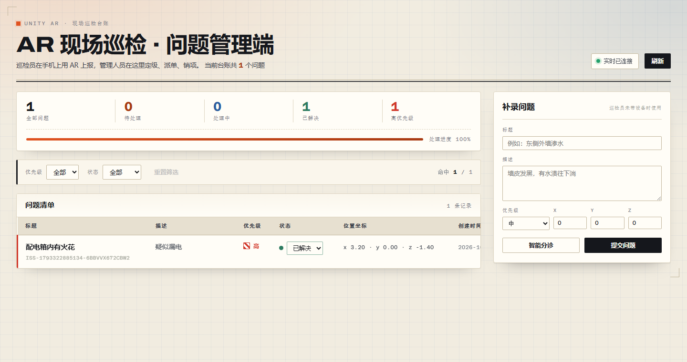
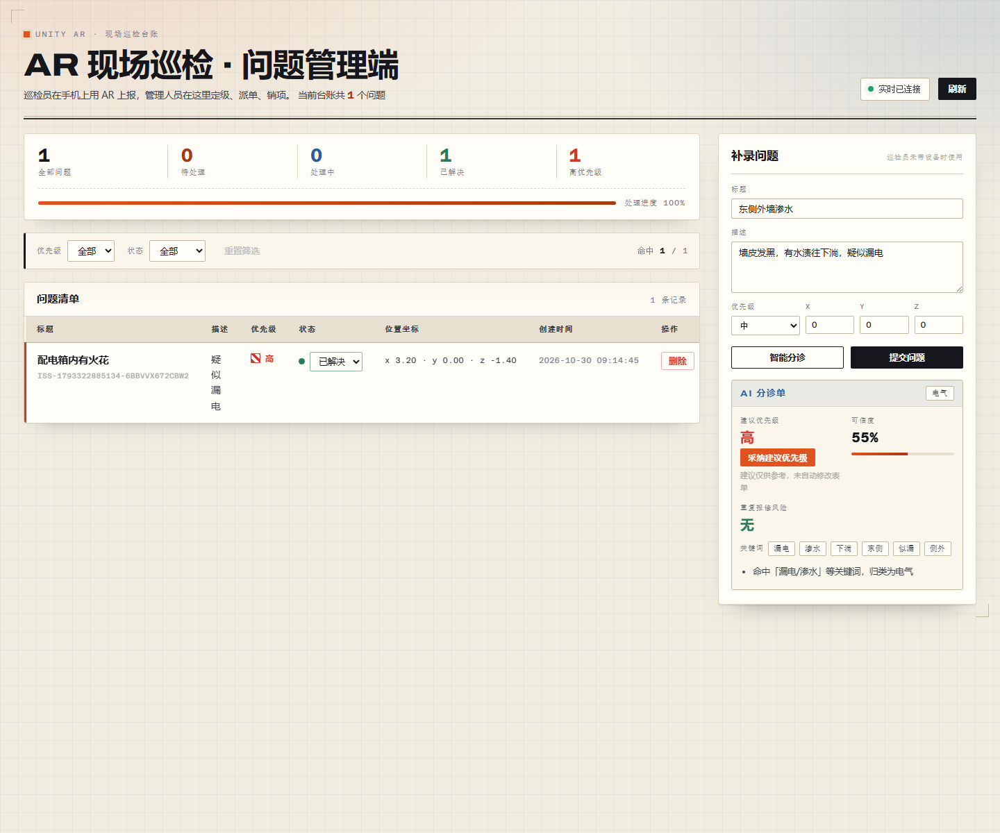

# Unity-AR 现场巡检问题标注（最小可运行原型）

园区巡检人员发现墙面破损、设备异常或安全隐患时，用手机在现场放置一个 AR 标记并上报问题；
管理人员在电脑网页里查看这些问题并更新处理状态。

本仓库打通了任务书要求的最小闭环：

```
Unity AR 放置标记并上报  →  Go 后端保存  →  React 页面查看问题  →  React 修改处理状态
```

| 管理端列表（真实后端 + 真实浏览器） | 后端不可用时的降级 |
| --- | --- |
|  |  |

> 📖 **想自己跑一遍看这里** → [`RUN.md`](RUN.md)（启动指南：后端 / 管理端 / 真机三部分怎么开，
> 以及所有已知坑的速查表）。
>
> 详细的分步记录（每一步先写的测试、失败原因、具体做了什么、验证结果、提交信息）见
> **[`docs/STEP_LOG.md`](docs/STEP_LOG.md)**；任务拆解与计划见 [`docs/PLAN.md`](docs/PLAN.md)；
> 测试总览见 [`docs/TEST_REPORT.md`](docs/TEST_REPORT.md)；AI 使用记录见 [`AI_LOG.md`](AI_LOG.md)。

---

## 1. 仓库结构

```
.
├── server/                     # Go 后端（零第三方依赖）
│   ├── cmd/server/main.go      #   入口：-addr / -data 参数、优雅退出
│   ├── internal/model/         #   Issue / Priority / Status / Position + 唯一 ID
│   ├── internal/store/         #   JSON 文件持久化（临时文件 + 原子 rename）
│   ├── internal/api/           #   HTTP 路由、CORS、参数校验、统一错误结构
│   └── data/                   #   运行时数据目录（issues.json 已被 .gitignore 忽略）
├── web/                        # React + TypeScript 管理端
│   └── src/                    #   api.ts / App.tsx / components/ / __tests__/
├── unity/                      # Unity AR 客户端（AR Foundation）
│   ├── Assets/Scripts/Core/    #   纯逻辑（不依赖 UnityEngine，可被 .NET 单测编译）
│   ├── Assets/Scripts/Ar/      #   AR 会话、平面检测、标记放置
│   ├── Assets/Scripts/UI/      #   表单、API 客户端、状态条、后端地址设置
│   ├── Assets/Scripts/Input/   #   新旧输入系统兼容的点击抽象
│   ├── Assets/Editor/          #   一键准备（TMP/场景/Android 设置）+ 一键打包
│   └── Assets/Tests/EditMode/  #   NUnit 用例（Unity Test Runner 可直接跑）
├── tools/UnityLogicTests/      # .NET 测试工程：链接同一批 Core 源文件，无 Unity 也能跑单测
├── tools/SyntaxCheck/          # Roslyn 语法检查（无 Unity 环境下查语法错误）
├── scripts/e2e.mjs             # 三端联调端到端脚本（真实后端 + 真实浏览器）
├── scripts/build_android.ps1   # Android 打包脚本（自动处理中文路径限制）
└── docs/                       # 规划、逐步记录、测试报告、截图
```

## 2. 技术栈与版本（全部为开发机实测版本）

| 部分 | 技术 | 版本 |
| --- | --- | --- |
| 后端 | Go（只用标准库 `net/http`） | go1.27.3 windows/amd64 |
| 存储 | 本地 JSON 文件 + 原子写 | — |
| 管理端 | React 18.3 + TypeScript 5.7 + Vite 5.4 | Node v24.14.1 / npm 11.11.0 |
| 管理端测试 | Vitest 2.1 + @testing-library/react 16 + jsdom | — |
| 移动端 | Unity LTS + AR Foundation | **Unity 2022.3.62f3c1**（中国区发布版）+ AR Foundation 5.1.5 |
| 移动端测试 | NUnit（Unity Test Framework 1.1.33） | 同一批用例也能用 .NET 8.0.427 跑 |
| 端到端 | Playwright（无头 Chromium） | — |

### 为什么选 Unity 2022.3 LTS + AR Foundation 5.1.5
AR Foundation 6.x 对 `ARSessionState`、`ARCameraManager`（不再有公开的 `camera` / `trackingType`）做了较大改动，
而 5.1.5 的 API 更稳定、社区资料更多。**所有用到的 AR API 都逐个对照过 5.1.5 包内源码的签名。**

### 移动端的实际验证状态
| 项 | 状态 |
| --- | --- |
| Unity 编译器 | ✅ **真实编译通过**，0 error 0 warning |
| Unity Test Runner（EditMode） | ✅ **61 个用例在真 Unity 里全部通过** |
| Android APK | ✅ **已产出**（18.1 MB，IL2CPP + arm64-v8a），并已在真机安装 |
| 真机 AR（平面检测 / 放置 / 上报） | ⏳ 需要你本人操作手机完成最后一步（见第 7 节） |

## 2.5 管理端的视觉与交互设计

按 `frontend-design` skill 重做，设计主张是把它做成一本「**现场巡检台账**」，而不是又一个后台模板：

- **材质**：牛皮纸/米白底 + 极淡的网格纹理，像一本真的纸质台账；
- **排版**：标题用有性格的西文 display 字体（中文回落 PingFang SC / 微软雅黑），
  数字与问题 ID 用等宽字体，强化「台账」的工业感；
- **色彩**：暖白纸面 + 墨黑文字 + **一个朱红**作为唯一强调色（高优先级、处理进度条都用它），
  其余状态用低饱和的绿/灰，避免花哨；
- **信息层级**：顶部统计条（总数/待处理/处理中/已解决/高优先级）+ 处理进度条 →
  筛选区 → 问题清单 → 右侧「补录问题」侧栏；
- **动效**：进场 stagger、状态切换过渡、实时连接指示、Toast 提示——克制，不用炫技动画。



### 2.6 AI 智能分诊怎么用

1. 管理端右侧「补录问题」面板填好标题/描述 → 点「**智能分诊**」；
   Unity 端表单里也有同一个按钮。
2. 返回：**建议优先级**、**问题类别**、**可信度**、**重复报修风险**、**关键词**、**理由**、**相似历史问题**。
3. 建议**不会**自动改你填的值 —— 要采纳得点「采纳建议优先级」。
4. 后端实现见 `server/internal/analysis/`，是**纯本地算法**（中文 2-gram 分词 + TF-IDF 余弦 +
   3D 距离 + 巡检类别规则表），**不调用任何外部大模型 API**，离线可用、毫秒级响应、结论可解释。



## 3. 快速开始

### 3.1 启动 Go 后端

```powershell
cd server
go run ./cmd/server                      # 监听 :8080，数据写入 server/data/issues.json
go run ./cmd/server -addr :9000          # 自定义端口
go run ./cmd/server -data ./db/issues.json # 自定义数据文件
```

健康检查：`curl http://localhost:8080/api/health`
→ `{"issues":0,"service":"unity-ar-inspection","status":"ok"}`

### 3.2 启动 React 管理端

```powershell
cd web
npm install
npm run dev        # http://127.0.0.1:5173
```

浏览器打开 <http://127.0.0.1:5173> 即可。
后端地址默认 `http://localhost:8080`，改法见 [`web/README.md`](web/README.md)：
复制 `.env.example` 为 `.env` 并设置 `VITE_API_BASE_URL`（**改完要重启 `npm run dev`**）。

其它脚本：`npm run build`（类型检查 + 生产构建）、`npm run test:run`（单测）、`npm run typecheck`。

> 没有 Go 环境时，可以用 `npm run mock:api` 启动一个按同一契约实现的本地 mock 后端。

### 3.3 打开 Unity AR 客户端

```powershell
# 用 Unity 2022.3.62f3c1 打开
"E:\Unity\Editors\2022.3.62f3c1\Editor\Unity.exe" -projectPath "E:\简历题目\unity"
```

首次打开需要联网拉取 `Packages/manifest.json` 里声明的包（AR Foundation 等），约 5–15 分钟。

之后跑一次菜单 **Tools → AR 巡检 → 生成巡检场景** 即可得到完整场景（相机 + AR Session +
平面检测 + 射线 + UI 表单 + 全部组件连线）。全部准备动作也可以一条命令搞定：

```powershell
# 导入 TMP 资源（必须先做，否则界面文字不显示）
Unity.exe -batchmode -quit -nographics `
  -importPackage "E:\简历题目\unity\Library\PackageCache\com.unity.textmeshpro@3.0.6\Package Resources\TMP Essential Resources.unitypackage" `
  -projectPath "E:\简历题目\unity"

# 生成场景 + 配置 Android + 启用 ARCore Loader
Unity.exe -batchmode -quit -nographics `
  -executeMethod UnityAR.EditorTools.ProjectSetup.PrepareAll `
  -projectPath "E:\简历题目\unity"
```

## 4. Unity 真机如何配置 Go 后端地址

真机上的 `localhost` 指的是手机自己，**连不到开发机上的 Go 后端**。有两种做法：

| 方式 | 做法 | 适用场景 |
| --- | --- | --- |
| ① **adb reverse（推荐，演示最稳）** | 电脑上执行 `adb reverse tcp:8080 tcp:8080`，App 里后端地址填 `http://localhost:8080` | 手机用数据线连电脑，**不受 WiFi / IP 变化 / 防火墙影响** |
| ② 局域网 IP | App 里填电脑的局域网 IP，如 `http://192.168.124.10:8080`（用 `ipconfig` 查，且**每次可能变**） | 手机和电脑同 WiFi 的真实巡检场景 |

Unity 里的入口：场景中的 `App` 物体 → `Backend Settings` 组件 → `Base Url`。
改完会写进 PlayerPrefs，下次启动自动带上。

其它注意事项：
- 手机和电脑必须在**同一局域网**（方式②），电脑防火墙要放行 8080 端口。
- Android 9+ 默认禁止 `http://` 明文流量，必须在 **Project Settings → Player → Other Settings → Allow downloads over HTTP** 打开
  （本项目的 `ArProjectSettings.ConfigureAndroid()` 已设 `PlayerSettings.insecureHttpOption = AlwaysAllowed`）。
- 地址末尾多余的 `/` 会被自动去掉（`BackendConfig.NormalizeBaseUrl`）。

## 5. 接口说明

Base URL 默认 `http://localhost:8080`，路径与响应格式由本项目自行设计（任务书允许）。
CORS 已放开，React 可以直接跨域访问。

| 方法 | 路径 | 请求体 | 成功响应 |
| --- | --- | --- | --- |
| GET | `/api/health` | — | `{"status":"ok","service":"unity-ar-inspection","issues":3}` |
| GET | `/api/issues` | — | `{"issues":Issue[],"count":3}` |
| POST | `/api/issues` | `{"title":"…","description":"…","priority":"high","position":{"x":0.42,"y":0.03,"z":1.26}}` | `201 {"issue":Issue}` |
| PATCH | `/api/issues/{id}/status` | `{"status":"in_progress"}` | `200 {"issue":Issue}` |
| POST | `/api/issues/{id}/status` | 同上 | 同上（兼容不支持 PATCH 的客户端） |
| DELETE | `/api/issues/{id}` | — | `200 {"deleted":"ISS-..."}` |

`Issue` 结构（三端字段名完全一致）：

```json
{
  "id": "ISS-1792988466562-SAAEVOZKQGIAC",
  "title": "入口墙面破损",
  "description": "左侧墙体存在裂缝",
  "priority": "high",
  "status": "open",
  "position": { "x": 0.42, "y": 0.03, "z": 1.26 },
  "createdAt": "2026-10-26T12:50:23.1234567+08:00",
  "updatedAt": "2026-10-26T12:50:23.1234567+08:00"
}
```

错误响应统一为：

```json
{ "error": { "code": "invalid_argument", "message": "标题(title)不能为空", "field": "title" } }
```

| code | HTTP | 含义 |
| --- | --- | --- |
| `invalid_argument` | 400 | 参数不合法（标题为空、priority/status 不在枚举内、坐标非有限数、字段超长） |
| `invalid_json` | 400 | 请求体不是合法 JSON |
| `not_found` | 404 | 问题 ID 不存在 / 未知路径 |
| `method_not_allowed` | 405 | 路径存在但 HTTP 方法不对（例如 `PUT /api/issues`） |
| `internal_error` | 500 | 服务端异常（**细节只进服务端日志，不会把文件路径回给客户端**） |

## 6. 测试

| 层 | 命令 | 结果 |
| --- | --- | --- |
| Go 后端 | `cd server && go test ./...` | **57** 个用例全部通过 |
| Go 静态检查 | `cd server && go vet ./... && gofmt -l .` | 无告警 |
| React 单测 | `cd web && npm run test:run` | **62** 个用例全部通过 |
| React 类型 / 构建 | `npm run typecheck` / `npm run build` | 0 错误 / 构建成功 |
| **Unity 编译** | `Unity.exe -batchmode -quit -nographics -projectPath unity` | **0 error 0 warning**，4 个程序集全部生成 |
| **Unity Test Runner** | `Unity.exe -batchmode -runTests -testPlatform EditMode -projectPath unity` | **89** 个用例全部通过（真 Unity 内执行） |
| Unity 纯逻辑（无 Unity 环境） | `dotnet test tools/UnityLogicTests/UnityLogicTests.csproj` | **89** 个用例全部通过（同一批源文件） |
| Unity C# 语法检查 | `dotnet run --project tools/SyntaxCheck -- unity/Assets` | 28 个文件、0 个语法错误 |
| 三端端到端 | `node scripts/e2e.mjs` | **27** 条断言全部通过（真实后端 + 真实浏览器） |
| **合计** | | **235** 个自动化断言 |

端到端脚本会自己编译并启动 Go 后端、启动 Vite、用无头 Chromium 跑完
「上报 → 列表看到 → 改状态 → 杀掉后端不白屏 → 重启后数据仍在」，截图写到 `docs/screenshots/`。

## 7. 真机演示脚本

> **演示视频未提供**：录制需要真实操作手机，而 AI 无法代替人操作真机。
> 下面是逐条可执行的步骤；其中管理端部分已由 `scripts/e2e.mjs` 自动化验证并留下了截图。

### 7.0 准备（一次性）

> **现成的 APK**：`release/UnityAR-Inspect.apk`（30 MB，IL2CPP + arm64-v8a + ARCore）。
> 评审不需要装 Unity，直接
> `adb install -r -g release/UnityAR-Inspect.apk` 即可装到支持 ARCore 的安卓手机上。

```powershell
# ① 电脑起后端（演示期间不能停）
cd E:\简历题目\server
go run ./cmd/server

# ② 电脑起前端
cd E:\简历题目\web
npm run dev

# ③ 手机连电脑后，建立端口隧道（这样手机用 localhost 就能连到电脑后端）
E:\Unity\Editors\2022.3.62f3c1\Editor\Data\PlaybackEngines\AndroidPlayer\SDK\platform-tools\adb.exe reverse tcp:8080 tcp:8080

# ④ 装 APK（已装过可跳过）
adb install -r -g E:\简历题目\build\UnityAR-Inspect.apk
```

### 7.1 手机端（约 3–5 分钟）

1. 打开 App（图标名「园区巡检 AR」），**缓慢平移手机扫描地面**。
   顶部提示变成「检测到 N 个水平平面，点击地面放置标记」。
2. **点击地面** → 出现立方体标记，顶部显示「已放置标记 位置: (x, y, z)」，
   填写面板自动打开。
3. 填写标题「入口墙面破损」、描述「左侧墙体存在裂缝」、优先级「高」，
   点「提交问题」→ 底部提示「上报成功，问题编号 ISS-…」，标记颜色变成红色（高优先级）。
4. **顺手验证**：填写面板打开时，在输入框/按钮上随意点击 —— 场景里**不会**冒出新标记
   （这是任务书点名要求的「点击按钮或输入框时不应误放标记」）。

### 7.2 电脑端（约 3–5 分钟）

5. 浏览器打开 <http://127.0.0.1:5173>，点右上角「刷新」
   → 列表里出现刚上报的问题，坐标和手机上一致。
6. 把该行状态下拉改成「处理中」再改成「已解决」→ 界面即时更新，后端也真的变了。
7. `Ctrl+C` 停掉 Go 后端 → 页面出现红色错误条 + 「重试」按钮，**页面不白屏**；
   再 `go run ./cmd/server` 重启 → 点「刷新」→ **问题和状态都还在**。

## 8. 已完成 / 未完成 / 已知问题

### ✅ 已完成
- **Go 后端**：健康检查、接收并保存问题、返回列表、按 ID 改状态、生成唯一 ID、默认 `open`、
  标题为空与枚举非法返回明确参数错误、**重启后数据仍存在**、Unity 与 React 共用同一后端同一份数据、
  React 在浏览器中可正常跨域访问。零第三方依赖。
- **React 管理端**：列表显示标题/描述/优先级/状态/坐标/时间；状态可改为 `open`/`in_progress`/`resolved`；
  **后端不可用时显示错误条 + 重试按钮，不白屏**；空态、加载态、总数、手动刷新；
  加分项：优先级/状态筛选、删除（二次确认）、**WebSocket 实时更新**、**AI 智能分诊面板**、
  **全新亮色视觉设计**（详见第 2.5 节）。
- **Unity AR 客户端**：AR Foundation 水平平面检测 → 射线命中处放置立方体标记 →
  填写标题（必填）/描述（可选）/优先级（低/中/高）→ 上报坐标 → 成功/失败明确提示；
  **点按钮/输入框不会误放标记**（三重保障）；后端地址可配置；
  标记按优先级着色；**场景一键生成**；**Android AR 设置一键配置**；**APK 一键打包**。
- **实时协同**：后端提供 **WebSocket**（`GET /ws`），Unity 上报 / 状态变更会**立刻**推到管理端，
  管理端无需刷新；断线指数退避重连。
- **AI 智能分诊**：后端纯本地算法（中文 2-gram 分词 + TF-IDF 余弦 + 3D 距离 + 规则表），给出
  **建议优先级**、**问题类别**、**重复报修风险**与**相似历史问题**；
  管理端与 Unity 端都有入口。**建议只是建议**，不自动改用户填的值。
- **Unity 历史问题列表**：手机端可查看全部历史问题，并直接把某条改成 待处理/处理中/已解决，或删除。
- **AR 标记样式随状态变化**：优先级决定色相（低绿/中黄/高红），状态决定形态
  （待处理实心 / 处理中放大 / 已解决半透明缩小）。
- **测试**：Go 57 + React 62 + Unity 89 + 端到端 27 = **235 个自动化断言**，
  另加 28 个 Unity 文件的 Roslyn 语法检查。
- **代码评审后修复的缺陷**（详见 `AI_LOG.md`）：Unity 侧两个**会导致工程编译不过**的问题
  （`namespace UnityAR.Input` 遮蔽 `UnityEngine.Input`、`TMP_InputField.viewport` 在 TMP 3.0.6 中应为 `textViewport`）；
  「点按钮会误放标记」的两处真实漏洞（EventSystem 命中判定有一帧延迟、面板收起后仍拦截屏幕下半部分）；
  后端 500 响应泄露文件路径；前端响应体不做运行时校验可能白屏；后端进程被杀时 fetch 挂死导致页面无任何提示。

### 🎁 已实现的加分项
- **WebSocket 实时更新**：Unity 上报 / 状态变更 / 删除实时推到管理端，断线指数退避重连，界面有连接状态指示。
- **Unity 历史问题列表与编辑**：查看全部历史问题，直接改状态或删除。
- **AR 标记样式随优先级与状态变化**。
- **AI 智能分诊**：建议优先级 + 类别 + 重复报修风险 + 相似问题（纯本地算法，离线可用）。
- **管理端亮色重设计**（见 2.5）。
- React：优先级/状态筛选、删除（二次确认）、手动刷新、问题总数、空态/加载态、错误条 + 重试。
- Unity：真机后端地址可运行时修改并记忆（PlayerPrefs）、场景一键生成、
  Android/iOS AR 设置一键配置、命令行一键打包。
- 工程：零第三方依赖的 Go 后端、原子写持久化、E2E 冒烟脚本、Roslyn 语法检查工具、
  Unity 命令行一键准备/打包脚本。

### ⚠️ 未完成（如实说明）
1. **真机 AR 的最后一步没有由 AI 实测**：AI 能编译、能打包、能装机，但**无法代替人操作手机**，
   所以「真机识别平面 → 放置标记 → 提交」这条链路需要你按第 7 节走一遍。
2. **没有演示视频**：同上，第 7 节给了可复现脚本，管理端部分已有自动化截图。
3. **没有登录/权限**：属于加分项，未实现（当前任何人都能上报与改状态）。

### 🐛 已知问题与踩过的坑
1. **Unity 工程路径不能包含中文** —— Android 构建工具链会直接报错：
   `Project path '...' contains non-ASCII characters ... Android Tools don't work properly with non-ASCII paths.`
   本仓库放在 `E:\简历题目\unity` 下，因此**打包必须先复制到纯 ASCII 目录**。
   `scripts/build_android.ps1` 已经把这个流程封装好了（复制 → 打包 → APK 拷回）。
2. **ARCore 不支持 Vulkan** —— Unity 2022.3 的 Android 默认图形 API 含 Vulkan，
   打包会失败：`BuildFailedException: You have enabled the Vulkan graphics API, which is not supported by ARCore.`
   必须显式设为 OpenGLES3（脚本已处理）。
3. **ARCore 的 XR Loader 必须为 Android 启用** —— 对应 GUI 的
   Project Settings → XR Plug-in Management → Android → ARCore。脚本已处理，
   生成的 APK 里能看到 `uses-feature: android.hardware.camera.ar`。
4. **TMP 资源要用 `-importPackage` 导入** —— `TMP_PackageResourceImporter.ImportResources()` 走的是
   异步 `AssetDatabase.ImportPackage`，batchmode 下 `-quit` 会来不及完成，资源不会落地。
5. **后端进程被杀时浏览器请求可能挂死**（keep-alive 半开连接）——
   已用请求超时兜底：默认 8 秒后转成 `NetworkError`，页面显示
   「请求超时（N 秒），后端可能未启动或网络不通」并给出重试按钮。
6. **priority 必填** —— 任务书只要求「标题必填」，本实现把 `priority` 也做成必填
   （避免「客户端没传、后端默默猜一个」的歧义）。若评审希望可缺省，
   改 `server/internal/api/server.go` 的 `handleCreateIssue` 一处即可。
7. **单机存储** —— 后端数据存在本地 JSON 文件，只支持单实例。多实例需换 SQLite/PostgreSQL
   （`server/internal/store/store.go` 是唯一的持久化边界，替换面很小）。
8. **Unity 场景是脚本生成**而非提交 `.unity` 文件（原因见 3.3）—— 不过现在**已经生成并纳入版本库**了。
9. **`web/scripts/mock-backend.mjs`** 是给「没有 Go 环境」的评审用的 mock，**不是后端实现**，
   真实后端在 `server/`。

## 9. AI 使用记录

见 [`AI_LOG.md`](AI_LOG.md)。里面逐条记录了本次开发中发给 AI 的原始 Prompt、AI 给出的结果、
我如何验证、以及最终**采纳 / 修改后采纳 / 未采纳**的判断（含至少一次放弃 AI 建议的记录）。
